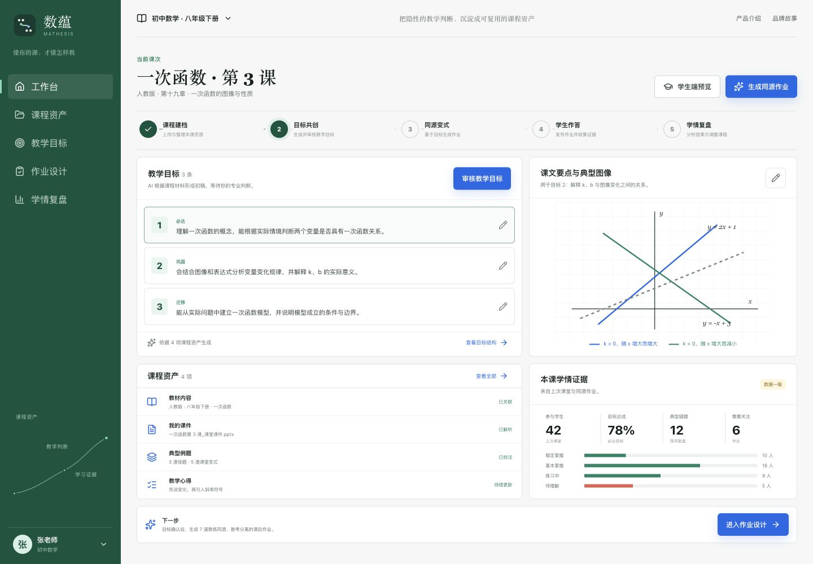

# 数蕴 MATHESIS

> 为每位数学老师定制一个懂 TA 课程的 AI 助教。

数蕴面向公校与教育机构的班课数学教师。它围绕某位老师、某个班级和某门课程，持续沉淀教材、讲义、课堂例题、教学目标、教法偏好与学生学习证据，辅助教师完成作业设计、错因诊断、学情分析和课程复盘。

数蕴不是通用拍题工具，也不是自动教学系统。AI 负责理解上下文、整理材料、生成变式与解释证据；教师始终保留目标确认、内容审核和教学决策权。



<p align="center">教师工作台 · 课程资产、教学目标、同源作业与学情证据</p>

## 产品主张

### 懂你的课，才懂怎样教

通用 AI 能回答一道题，却不知道这节课讲过什么、老师采用了什么方法、哪些内容暂时不应该考查。数蕴从教师自己的课程上下文开始，让每一次生成与诊断都回到真实课堂。

### 教练同源，教考分离

作业与课堂例题保持知识点、方法模型、易错点和教学目标同源，但通过数值、条件、结构、问法、表征或情境变化，避免机械复刻，检验学生是否真正理解和迁移。

### 群体优先，证据下钻

教师端先看班级整体，再下钻到模块、知识点、题型、错因、学生群体和个体。系统提供教学证据与建议，不因单个异常直接调整课程。

## 核心闭环

```text
课程建档
  → 教学目标共创
  → 同源变式作业
  → 学生作答
  → 批改与错因诊断
  → 订正和迁移训练
  → 班级学情分析
  → 课程复盘
  → 课程资产持续更新
```

## 当前产品预览

首页是可交互的教师工作台，包含：

- 课程资产与课次上下文
- 教学目标生成、切换与教师确认
- 一次函数典型图像与目标关联
- 教练同源、教考分离的作业结构
- 学生端答题与订正体验
- 班级目标达成和错因复盘
- 独立的产品介绍与品牌故事页面

当前界面使用经过标注的示例数据展示完整产品逻辑。数据库已经建立教师、学生、班级、课程、课次、目标、作业和提交的基础结构；正式试用还需要接入公共身份认证与真实课程数据写入接口。

## 品牌故事

“数”指数学，也指结构、证据与推理；“蕴”指一门课中没有被完整说出的教学经验、方法模型和学习规律。

数学里，`∵` 表示“因为”，`∴` 表示“所以”。数蕴希望帮助教师和学生走完中间那条路：

> 让每一个“为什么”，抵达“所以”。

品牌承诺是：**为教师保留判断，为学生保留思考。**

## 页面

- `/`：教师工作台与学生端预览
- `/about`：产品介绍、核心闭环与设计原则
- `/story`：数蕴品牌故事

## 技术结构

```text
React 19 + TypeScript + vinext
               │
       Cloudflare Worker
               │
        Cloudflare D1
教师 / 班级 / 课程 / 目标 / 作业 / 提交
```

项目采用 React 19、TypeScript、vinext、Cloudflare Worker、D1 和 Drizzle ORM。所有授权与数据所有权判断必须在服务端完成；浏览器状态只用于当前界面交互，不作为正式课程数据的来源。

## 本地运行

环境要求：Node.js `>=22.13.0`。

```bash
npm install
npm run dev
```

默认访问 `http://localhost:3000`。

## 构建与测试

```bash
npm test
```

测试会完成生产构建，并检查首页、产品介绍、品牌故事、健康接口以及仓库中是否残留已移除的参赛集成。

## 项目状态

当前版本回到数蕴最初的产品构想，并完成可交互产品预览、品牌表达和第一阶段业务数据模型。下一步是接入教师正式登录、班级码与学生稳定身份，再邀请 1–3 位数学教师完成真实课程试用。
